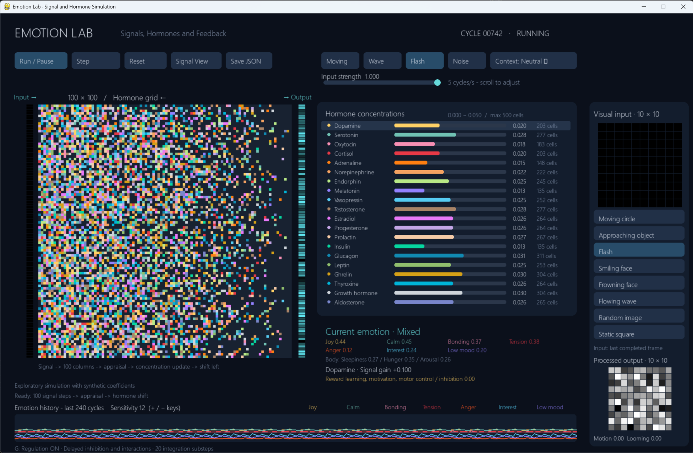
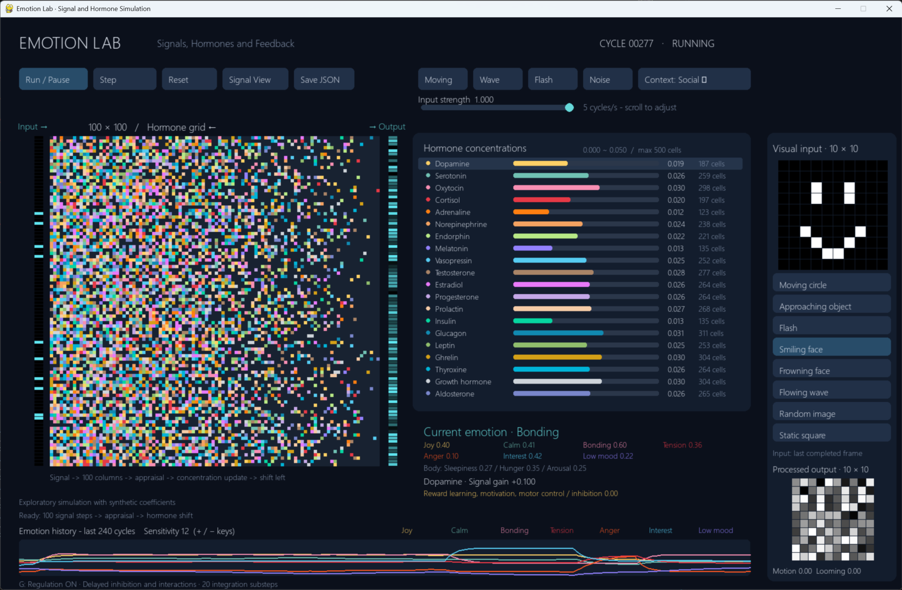

# Emotion Lab

Emotion Lab explores how incoming signals can change hormone concentrations and produce measurable emotional responses. Its purpose is to receive signals, reflect their effects in hormone concentration regulation, and quantify emotions as numerical scores in a dynamic simulation.

Current hormone levels influence how each signal is interpreted, so the same stimulus can produce different emotional responses under different internal states. The resulting emotion scores feed back into secretion, while delayed inhibition and interactions between hormones regulate concentrations over time.

```text
Incoming signals + current hormone state
                  -> stimulus interpretation
                  -> numerical emotion scores
                  -> secretion and hormone concentration regulation
                  -> internal state for the next signal
```

The simulation supports experiments with repeated or identical signals to observe how hormone interactions change emotional responses and help them stabilize or recover.





## Features

- 100 x 100 hormone grid with 20 chemical signal types, distinct colors, and selectable profiles.
- 100 parallel input signals processed across all 100 grid columns.
- Eight synthetic 10 x 10 visual scenes: moving circle, approaching object, flash, smiling face, frowning face, flowing wave, random image, and static square.
- Adjustable input strength, playback speed, context, and channel sensitivity.
- State-dependent stimulus interpretation using current hormone concentrations.
- Eight emotion scores: Joy, Calm, Bonding, Anxiety, Anger, Interest, Low mood, and Boredom. Similar leading scores produce a Mixed label.
- Familiarity and habituation that reduce interest and reward secretion during prolonged exposure to an unchanged screen; changed input restores engagement.
- Separate novelty and signal-order estimates: predictable patterns support Calm, while irregular changing input supports Anxiety rather than Interest.
- Configurable habituation speed for modeling different attention durations. The default uses a short attention duration, so repeated input loses interest relatively quickly.
- Emotion feedback that adjusts secretion before the next concentration update.
- Delayed inhibition, cross-hormone stimulation and suppression, secondary secretion, and concentration-dependent clearance.
- Regulation toggle for comparing responses with and without the interaction network.
- Separate input/output images, signal-path view, concentration bars, body-state indicators, and 240-cycle emotion history.
- JSON export of the current state, interpretation, emotion scores, concentrations, regulation settings, and recent history.
- Reproducible constant-input experiments with CSV traces, JSON summaries, and an SVG comparison chart.

## Installation and launch

Requires Python 3.10 or later.

```powershell
py -m pip install -r requirements.txt
py main.py
```

Use `python` instead of `py` if that is the available command.

## Controls

| Control | Action |
|---|---|
| Space / Run-Pause | Toggle playback |
| Right arrow / Step | Advance one cycle |
| R / Reset | Restore the seeded initial state |
| G | Toggle delayed regulation and hormone interactions |
| + / - | Adjust channel sensitivity from 2 to 30 |
| Mouse wheel | Adjust playback speed from 1 to 20 cycles per second |
| Strength slider | Set input intensity from 0 to 1 |
| Context button | Cycle through Neutral, Reward, Threat, Social, Night, and Meal |
| Scene buttons | Select a visual scene |
| Hormone row | Select a profile and view its signal gain and inhibition level |
| Signal View | Toggle the grid and last signal path |
| Save JSON | Write `simulation_snapshot.json` in the current directory |

## Simulation cycle

1. Generate the next visual frame and flatten its pixels into 100 input signals.
2. Process signals through the stationary hormone grid. Each occupied cell adds its profile's signal gain; values stay within 0 to 1.
3. Extract visual features and channel responses, then interpret the stimulus using current hormone levels.
4. Evaluate the complete emotion vector and adjust secretion drives.
5. Integrate secretion, clearance, delayed inhibition, and interactions using 20 internal substeps.
6. Shift the grid one cell left and reconcile occupancy with updated concentrations.

Each concentration ranges from 0 to 0.050 and corresponds to `round(concentration * 10000)` cells. The displayed emotion is the evaluation used for the current cycle's secretion; concentration bars show the resulting state.

## Experiments and tests

```powershell
py experiment_regulation.py
py experiment_habituation.py
py -m unittest -v
```

Experiments write `experiments/regulation.svg`, `experiments/summary.json`, and four CSV traces. They compare constant secretion drives with regulation enabled/disabled and identical inputs under different initial hormone states. The latter experiment isolates concentration-dependent interpretation by clearing the spatial grid before each cycle.

Tests cover signal propagation, occupancy, emotion responses, delayed regulation, recovery, long-run bounds, and integration convergence.

Habituation experiments write `experiments/habituation.csv` and `experiments/habituation-summary.json`. They measure a repeated smiling image, a subsequent screen change, and flowing-wave versus random input responses. Familiarity, novelty, boredom, order, and disorder are also displayed and exported with simulation snapshots.

## Attention duration

Different attention durations can produce different rates of interest loss under identical input. The default `Simulation.habituation_rate = 0.04` models a short attention duration: familiarity builds quickly, reward and arousal secretion decrease, and boredom rises. A lower rate models slower adaptation and maintains interest longer. This parameter describes simulation behavior, not a measured human attention span. Its time scale is cycles; playback speed changes how quickly cycles pass on screen. Attention-duration presets are not currently available in the interface.

Model parameters, assumptions, and reference links are documented in [HORMONE_MODEL.md](HORMONE_MODEL.md). Concentrations and interaction coefficients are synthetic simulation values.
